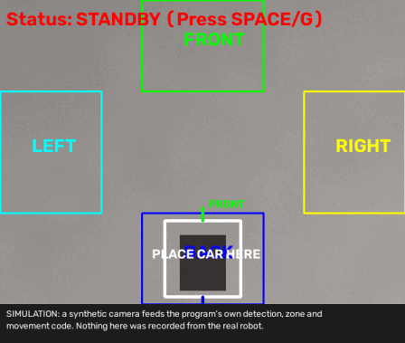

# SmartDustbin: a vision-guided trash bin, with a simulator that tests it without hardware

A webcam finds a red object thrown into one of four zones and a robot bin is told to drive towards it. The original project ran on a real ESP32 robot. This version splits the script into tested modules and adds a **software simulation and evaluation harness**: on 1,200 synthetic scenes the original detector makes the right decision **77.0%** of the time on average, and **85.5%** with a one-line fix found by the harness (a red mark on the robot itself triggered the BACK zone in 100% of those scenes).

> **What is and is not verified.** The original project was built and tested on a physical ESP32 robot (per its authors; no photos, video or measurements are in this repository). Everything measured *in this repository* (the animations, the evaluation tables, the layout analysis) comes from synthetic images and a modelled robot, and was **not** run on the hardware. Accuracy figures describe the code's behaviour on the scenes built here, not real-world performance.

## Problem

A bin that goes to where trash lands has to answer three questions from one overhead camera: is there trash, where is it, and how should the robot move. The original author's answer is a colour threshold, four fixed zones and a timed movement per zone. This repository asks how far that simple design goes, and where it breaks.

## How it works

```
camera frame -> HSV red mask -> largest blob (>= 500 px²) -> centre point -> zone lookup
             -> movement plan (timed commands U/D/L/R, S to stop) -> ESP32 over Bluetooth
```

| Zone | Where (share of frame) | Movement sent |
|---|---|---|
| FRONT | x 35-65%, y 0-30% | `U` 1.0 s, `S` |
| BACK | x 35-65%, y 70-100% | `D` 1.0 s, `S` |
| LEFT | x 0-25%, y 30-70% | `L` 0.5 s, `S`, `U` 1.0 s, `S` |
| RIGHT | x 75-100%, y 30-70% | `R` 0.5 s, `S`, `U` 1.0 s, `S` |

Control is open loop: the robot gets a fixed command sequence and the camera does not steer it afterwards. A 3-second cooldown stops one throw from triggering twice. Without `ESP_MAC` set the program runs in dry-run mode and prints the commands instead of sending them.

## Simulation

`python -m smart_dustbin simulate` throws a red object into a synthetic scene and runs the program's **own** detector, zone logic, movement plans and live loop against a software camera and a recording robot on a virtual clock. The robot's path is drawn from those recorded commands with a simple model: constant speed while `U`/`D` is held, and a turn rate of 180°/s taken from the original timing (90° in 0.5 s). **The forward speed is not known**, so 200 px/s is an assumption, stated on every frame of the animation.

| FRONT | BACK |
|---|---|
|  |  |
| **LEFT** | **RIGHT** |
|  |  |

In all four demos (seed 7) the object is detected at its exact position and the correct zone, and the correct commands are sent. The bin then ends **170 to 238 px from the object** (FRONT 170, BACK 185, LEFT 232, RIGHT 238) at the assumed speed. That miss is a property of the design: the movement does not depend on where in the zone the object is.

## Evaluation (synthetic)

`python -m smart_dustbin evaluate` renders 100 seeded scenes for each of 12 conditions and scores the zone decision (right zone, or no action when nothing should trigger). Full results: [`docs/evaluation.json`](docs/evaluation.json). Examples of every condition: [`docs/images/conditions.png`](docs/images/conditions.png).

| Condition | What it tests | Right decision | With keep-out mask | Centre error |
|---|---|---|---|---|
| clean scene | red trash in a random zone, good light | 99% | 99% | 0.1 px |
| dim light | image 45-80% as bright | 98% | 98% | 0.2 px |
| glare | 10-35% washed out towards white | 83% | 83% | 0.9 px |
| sensor noise | Gaussian noise (sigma 8-20) plus 0.5% salt-and-pepper | 81% | 81% | 1.2 px |
| motion blur | 9-21 pixel horizontal smear | 97% | 97% | 0.4 px |
| trash among look-alikes | red trash plus orange, brown, skin-tone, pink or dark-red objects | 97% | 97% | 0.1 px |
| two red objects | the larger one should win | 99% | 99% | 0.2 px |
| look-alikes only | no trash: should do nothing | 100% | 100% | |
| orange-red look-alikes | no trash; hue right at the edge of the accepted range | 70% | 72% | |
| small trash | area 200-380 px², below the 500 px² minimum | 0% | 0% | |
| trash outside every zone | should do nothing | 100% | 100% | 0.1 px |
| red mark on the car | 30 x 30 px red patch on the robot, no trash | 0% | 100% | |

Mean right-decision rate over the 12 conditions: **77.0%** original, **85.5%** with the keep-out mask. The scenes, the thresholds for "look-alike" and the condition ranges are my own choices, so the table shows where the code is fragile, not a benchmark.

### Findings

1. **The robot's own body is inside the BACK zone.** The car's box (260, 348)-(380, 468) covers 52% of the BACK zone (14,400 of 27,648 px²). Any red on the robot triggers a backward move. Ignoring that rectangle in the detector (`RedTrashDetector(ignore_rect=...)`) fixes it: 0% to 100% on that condition.
2. **Small trash is invisible by design.** Objects under 500 px² are ignored, so 200-380 px² objects score 0%.
3. **Glare and sensor noise cost the most** among realistic conditions (83% and 81%), since both push red pixels out of the accepted hue and saturation range.
4. **Orange-red objects at the hue boundary are mistaken for trash about 30% of the time** (70% correct).
5. **Identical timed moves cover very different distances.** From the geometry alone (`python -m smart_dustbin layout`, 640x480 frame, top-down camera assumed): LEFT and RIGHT zones have a median miss of 168 px and **0%** of positions inside the box's half-width after the move. FRONT needs 264-408 px of driving for one fixed second, BACK needs 0-72 px.

Closing the loop (steer towards the detected position until the distance is small) is the obvious next step; this repository deliberately keeps the original open-loop behaviour so the measurements describe the author's design.

## Run it

Python 3.11+ (developed on 3.15, Windows 11). No camera or robot is needed for the first three commands.

```powershell
git clone https://github.com/abdullahwaheed0112/SmartDustbin.git
cd SmartDustbin
python -m venv .venv
.venv\Scripts\activate
pip install -r requirements-dev.txt

python -m smart_dustbin simulate --zone LEFT      # prints the commands, writes docs/demo/demo-left.gif
python -m smart_dustbin evaluate --n 100          # the table above, about 1 minute
python -m smart_dustbin layout                    # geometry analysis
pytest                                            # 89 tests, about 40 s
```

Live mode (needs a webcam; Bluetooth only if `ESP_MAC` is set):

```powershell
python -m smart_dustbin live                      # dry run: commands are printed, nothing is sent
$env:ESP_MAC = "<your ESP32 Bluetooth address>"   # optional; never commit it
```

Keys are typed in the terminal: `G` or Space arms detection, `W/A/S/D` drive manually (forward/left/back/right), `X` stop, `1-4` run a zone movement for testing, `Q` quit (or `q` in the camera window). The Bluetooth path (`sudo rfcomm`, Linux) is the original author's code and was not exercised here.

## Project structure

```
smart_dustbin/
  config.py       constants and the ESP32 address (read from ESP_MAC)
  vision.py       ZoneManager, RedTrashDetector, locate_zone
  actions.py      movement plans per zone and the executor (cooldown, stop after each move)
  transport.py    Bluetooth, dry-run and recording transports
  app.py          live loop and keyboard control
  scenes.py       synthetic camera frames
  simulation.py   virtual clock, motion model, animation
  evaluation.py   12-condition evaluation and layout geometry
  __main__.py     command line
tests/            89 pytest tests
docs/             demo GIFs, evaluation.json, images/conditions.png
```

## Tech stack

Python, OpenCV (HSV thresholding, contours), NumPy, Pillow (GIFs), pytest. Hardware in the original: ESP32, L298N motor driver, DC motors, Bluetooth RFCOMM.

## My role and credit

This project began as a team project. It is a fork of [Fireguy1/SmartDustbin](https://github.com/Fireguy1/SmartDustbin), and its single original commit (`8813024`) is preserved unchanged.

- **Original project, my part:** the hardware implementation (building the physical robot: ESP32, L298N motor driver, DC motors). I tested the whole system on the ESP32 robot; the photos, wiring, firmware and test records from that build are not in this repository, so no hardware results are reported here.
- **Original project, Fireguy1's part:** the Python control script (detection, zones, Bluetooth code) in the first commit.
- **After the fork (mine):** the module split (verified to behave identically to the original on the same inputs), the `ESP_MAC` environment variable replacing a hard-coded Bluetooth address, the simulator, the evaluation and layout analysis, the tests, and this README.

## Limitations

- The simulation, evaluation and tests added here were not run on the real robot, and no hardware measurements (speed, turn accuracy, Bluetooth reliability) are recorded in the repository.
- The evaluation uses synthetic scenes of my own design. Real lighting, shadows, camera angle and trash shapes will differ.
- The layout analysis assumes a top-down camera and a bin about as wide as its placement box.
- No licence file was in the original repository, so none is added here.
